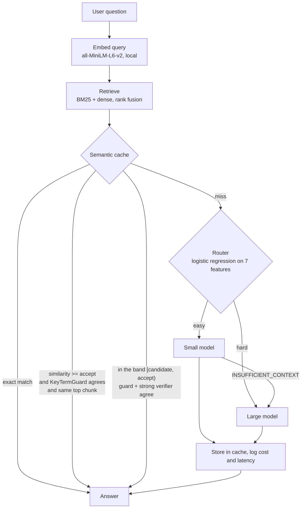
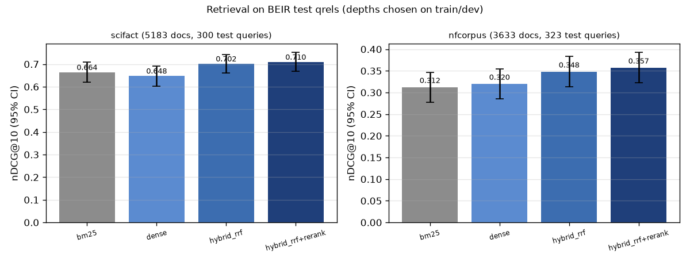
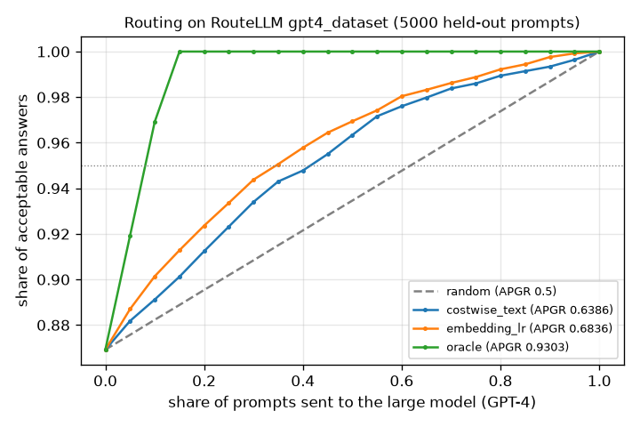
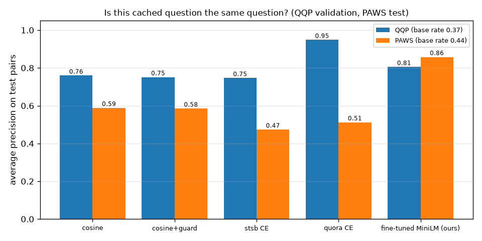
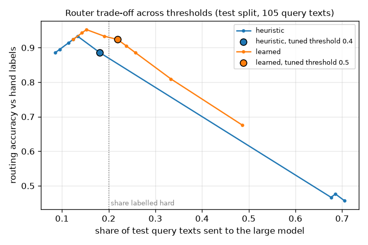

# Costwise RAG


A retrieval-augmented question-answering service that puts a **semantic cache** and a
**cost-aware model router** in front of the LLM, so cheap questions go to a small model,
repeated questions are answered from the cache, and only the hard ones pay for the large model.

The project's one claim is meant to be measured, not asserted: *lower LLM cost and p95 latency at
the same answer quality.* Every number below comes from a reproducible eval in this repo.

**At a glance** (public data, held-out test splits, no API cost; details in [Results](#results)):

| Component | Benchmark | Result |
|---|---|---|
| Hybrid retrieval | BEIR SciFact / NFCorpus | nDCG@10 0.702 / 0.348, +0.054 / +0.028 over dense (95% CIs above zero) |
| Router | RouteLLM, 5,000 held-out real prompts | 95% acceptable answers with 34% GPT-4 calls vs 62% random; simulated cost -71.8% |
| Cache verifier (fine-tuned on CPU) | PAWS adversarial paraphrases | average precision 0.86 vs 0.59 for cosine; 94% precision where no public model reaches 80% |
| Cache verifier on the service's stream | synthetic test stream, offline | wrong hits 5 -> 2 of 350 with a 15 ms local verifier |

Two small paid live runs (router; cache) on the service's own synthetic corpus are reported
with their limits.

## How it works



Code layout follows ports and adapters: the cache, router and pipeline are plain Python in
`src/costwise/domain/` with no I/O; embedders, retrieval indexes, verifiers, the OpenRouter client
and SQLite live in `src/costwise/adapters/`; FastAPI and the dashboard in `src/costwise/app/`; the
evals in `src/costwise/eval/`. Full design notes: [docs/ARCHITECTURE.md](docs/ARCHITECTURE.md).

## Design decisions

| Problem | Chosen | Alternatives considered | Why |
|---|---|---|---|
| When are two questions "the same"? | Embedding similarity, then **KeyTermGuard** (numbers must match as a set; units, plan names and contrast words must not be substituted), plus the same top retrieved chunk | Threshold only; always ask an LLM | Near-misses ("refund window for monthly" vs "annual") sit at the same similarity as true paraphrases; no single threshold separates them (see results). An LLM check on every lookup costs what the cache saves. |
| Cheap check vs accurate check | **Two thresholds**: above the accept threshold the free guard decides; in the band below it a strong verifier (small LLM YES/NO, or a cross-encoder) must also agree, at most once per lookup, its cost charged to the request | One threshold | Keeps the free path strict and pays for accuracy only where it is needed. |
| Cache freshness | TTL plus per-entry source-document hashes | Flush all on change; TTL only | Only answers built from a changed document are dropped. |
| Which model answers | Logistic regression on hand-made features (length, numbers, multi-part cues, clauses, documents in top-k, retrieval scores), plus escalation when the small model says the context is insufficient | Hand rules; embedding classifier (RouteLLM style); pure cascade (FrugalGPT style); LLM router | Works with 75 labelled rows, explainable; the cascade is the safety net. The heuristic router is kept as a baseline. |
| Retrieval | Hybrid BM25 + dense with reciprocal rank fusion, BM25 on an inverted index | Dense only; BM25 only; + cross-encoder reranker | Exact tokens ("3000", "Starter") and paraphrases both matter. On BEIR, hybrid beats dense by +0.054 / +0.028 nDCG@10 (CIs above zero). The reranker added only +0.008 / +0.009 (not significant) for 170-1,350x the latency on CPU, so it is off. |
| Router signal | Query features, plus an embedding-based variant measured on public data | Hand rules only | On RouteLLM's real prompts, the embedding router needs 34% GPT-4 calls for 95% acceptable answers, against 62% for random routing. |
| Storage, provider | NumPy brute-force search, SQLite, a thin `httpx` OpenRouter client | FAISS/Qdrant, Redis, LiteLLM | Zero setup at this size; each is a one-adapter swap. |

**Honesty rules:** thresholds and router weights are fitted on the **tune** split only and reported
on the **test** split. The corpus is a 12-document synthetic help-centre knowledge base
(39 chunks) with 60 questions (25 tune, 35 test), each with 2 paraphrases. Every percentage is
given with its counts.

## Results

### Public benchmarks (real data, no API cost, 22 Nov 2026)

Each part of the service was also measured on public data, at pinned dataset revisions, with
everything fitted on a train/tune split and scored on the held-out test split. None of these
needs an LLM call, so anyone can rerun them for free. They are **component** evals: the
end-to-end claim (lower cost at the same answer quality) still rests on the small live runs
further down.

**Retrieval: BEIR SciFact and NFCorpus** ([results/beir.json](results/beir.json),
`python -m costwise.eval.beir`). These are the service's own retrievers. The RRF constant and
depth (k=10, depth 300) and the rerank depth were chosen on 200 train/dev queries. The values
in brackets are 95% bootstrap CIs over test queries.

| Retriever | SciFact nDCG@10 (300 q) | NFCorpus nDCG@10 (323 q) | SciFact recall@100 | Search latency p50 (CPU) |
|---|---|---|---|---|
| BM25 (ours) | 0.665 [0.619, 0.710] | 0.312 [0.278, 0.346] | 0.889 | 1.4 ms |
| Dense, all-MiniLM-L6-v2 | 0.648 [0.603, 0.693] | 0.320 [0.286, 0.354] | 0.925 | 1.1 ms |
| **Hybrid RRF (what the service uses)** | **0.702** [0.662, 0.743] | **0.348** [0.314, 0.384] | **0.962** | 4.2 ms |
| Hybrid + ms-marco MiniLM reranker | 0.710 [0.670, 0.752] | 0.357 [0.323, 0.393] | 0.962 | 705 ms / 3.8 s |

- **The harness is checked against published numbers:** our BM25 gives 0.665 on SciFact (BEIR
  paper, Elasticsearch: 0.665), and MiniLM dense gives 0.648 (MTEB: 0.645).
- **Hybrid beats dense on both datasets, per query:** +0.054 nDCG@10 on SciFact (paired
  bootstrap 95% CI [+0.030, +0.080]) and +0.028 on NFCorpus ([+0.013, +0.044]).
- **The reranker was measured and left out:** its gain over hybrid is +0.008 and +0.009, with
  both CIs crossing zero, and it costs 0.7 to 3.8 s per query on a laptop CPU, which is 170 to
  1,350 times hybrid's latency.



**Routing: RouteLLM gpt4_dataset** ([results/routerbench.json](results/routerbench.json),
`python -m costwise.eval.routerbench`). The data is 10,000 real chat prompts, each with a GPT-4
answer, a Mixtral-8x7B answer, and a GPT-4 judge score of the Mixtral answer. A prompt "needs
the large model" when Mixtral scored 3 or lower out of 5: 654 of the 5,000 held-out prompts
(13.1%). The routers were fitted on the other 5,000. Cost is **simulated** from list prices and
answer lengths; no model was called.

| Router (prompt only) | APGR [95% CI] | GPT-4 calls for 95% acceptable answers | Simulated cost saving vs always GPT-4 |
|---|---|---|---|
| Random | 0.500 | 62% | 37.0% |
| Service router, text features only | 0.639 [0.622, 0.656] | 42% | 51.9% |
| **Logistic regression on the MiniLM query embedding** | **0.684** [0.664, 0.702] | **34%** | **71.8%** |
| Oracle (knows which prompts fail) | 0.930 | 9% | 89.0% |

- Always-Mixtral answers 86.9% of prompts acceptably. **The embedding router reaches 95% with 34%
  of prompts sent to GPT-4, against 62% for random routing** (45% fewer GPT-4 calls). Its
  regularisation was chosen on a hold-out inside the fit half.
- APGR is the share of the always-small-to-always-large quality gap that is recovered,
  averaged over every possible share of large-model calls (RouteLLM's metric; random = 0.5).
- The service router's 3 retrieval features do not exist for open chat prompts, so its row is
  a text-only variant, not the deployed router. The embedding router reuses the query
  embedding the service already computes for retrieval, so it adds no model call.
- Labels come from a GPT-4 judge, not from humans.



**Cache decisions: QQP and PAWS** ([results/paraphrase.json](results/paraphrase.json),
`python -m costwise.eval.paraphrase`). Each labelled pair is one cache lookup: serving the
cached answer is right only if the two texts are duplicates. QQP holds real duplicate questions.
PAWS is adversarial: its non-duplicates are made by swapping words, so they share almost every
word, which is the cache's worst case. The tune pairs are 3,000 from train; the test pairs are
5,000 from QQP validation and PAWS test.

| Score used to accept a cache hit | QQP average precision | PAWS average precision |
|---|---|---|
| Random (duplicate share) | 0.37 | 0.44 |
| Cosine similarity (MiniLM) | 0.76 | 0.59 |
| Cosine + KeyTermGuard | 0.75 | 0.58 |
| STS-B cross-encoder (public) | 0.75 | 0.47 |
| Quora cross-encoder (public, **trained on QQP**: leaked) | 0.95 | 0.51 |
| **Our fine-tuned MiniLM verifier** | **0.81** | **0.86** |



- **Off-the-shelf similarity is not safe for a cache when questions differ by a word or two.**
  On PAWS, cosine and both public cross-encoders sit close to the 0.44 base rate, and none of
  them reaches 80% precision at any threshold on tune.
- **So we trained a verifier.** It starts from the 22M-parameter ms-marco MiniLM cross-encoder
  and is trained for 2 epochs on 16,000 PAWS and 8,000 QQP *train* pairs, on a laptop CPU in 43
  minutes (`python -m costwise.eval.train_verifier`). It reaches PAWS average precision 0.86
  (cosine: 0.59). At a precision target of 0.90 chosen on tune, it serves 25% of PAWS duplicates
  at 94.0% test precision (36 wrong out of 5,000), where no other score reaches the target.
  It scores a pair in 15 ms on CPU.
- **KeyTermGuard is a closed-domain tool.** On QQP, the rule the service uses (any word
  capitalised mid-sentence is a key term) turned Title Case words and "I" into key terms and
  blocked 1,190 of 1,841 true duplicates. An open-domain rule chosen on tune (a word must be
  capitalised in at least 95% of its mid-sentence uses) blocks 142, and at an 80% precision
  target it cuts wrong hits from 213 to 181 of 5,000, with recall 0.43 against 0.44.
- Leakage: MiniLM's training mix includes Quora duplicates, and the Quora cross-encoder was
  trained on QQP train, so their QQP numbers are optimistic. No model here saw PAWS test or
  QQP validation.

**The strong verifier on the service's own cache stream** ([results/verifier.json](results/verifier.json),
`python -m costwise.eval.verifier_eval`). These are the 350-query test streams from the
offline cache eval below, now with a real model in the slot the "perfect verifier" upper bound
used. Score thresholds are fitted on the tune split.

| Strong verifier | Where it is asked | Repeats served (of 175) | Wrong hits (of 350) | ms per check (CPU) |
|---|---|---|---|---|
| None (the free config) | | 17 | 5 | 0 |
| STS-B cross-encoder | every candidate | 31 | 5 | 42 |
| STS-B cross-encoder | band below 0.88 | 40 | 10 | 42 |
| **Fine-tuned MiniLM (ours)** | **every candidate** | **21** | **2** | **15** |
| Quora cross-encoder | band below 0.88 | 17 | 15 | 58 |
| Perfect verifier (upper bound) | band below 0.88 | 134 | 5 | n/a |

- A local verifier has **no API cost**. The live run on 16 Nov showed that an LLM verifier's
  calls can cost more than the cache saves.
- The trade-off is real. The STS-B model serves 82% more repeats than the free config at the
  same 5 wrong hits. Our fine-tuned model cuts wrong hits from 5 to 2 and is 3x faster. All
  real verifiers stay far below the perfect-verifier bound of 134, so the verifier is still the
  cache's bottleneck.
- `data/tuned.json` selects the STS-B model, because it is chosen on tune among Hub models only.
  A model trained locally under `.state/` is not in a fresh clone or the Docker image.

### Offline (real, free to reproduce; from [results/offline.json](results/offline.json))

These need no LLM. They are real measurements, but on a small synthetic corpus, so they show the
method works rather than predict production numbers.

**Retrieval, test split, 105 queries, recall@4:** dense 102/105 (97.1%), BM25 98/105 (93.3%),
**hybrid 103/105 (98.1%)**.

**Cache, test split, 350-query stream with 175 repeats (5 stream seeds, repeat rate 0.5):**

| Variant (threshold from tune) | Hits | Correct | Wrong | Repeats served | Wrong-hit rate |
|---|---|---|---|---|---|
| Similarity threshold only (tune needs 0.99) | 0 | 0 | 0 | 0/175 (0%) | 0/350 (0%) |
| Guard + same evidence, accept 0.88 (the free config) | 22 | 17 | 5 | 17/175 (9.7%) | 5/350 (1.4%) |
| Upper bound: perfect strong verifier in the band [0.60, 0.88) | 139 | 134 | 5 | 134/175 (76.6%) | 5/350 (1.4%) |
| Upper bound: perfect strong verifier on every candidate | 138 | 138 | 0 | 138/175 (78.9%) | 0/350 (0%) |

The upper-bound rows assume a strong verifier that is never wrong; they bound what the paid LLM
verifier can reach. The last row was added after the 5 wrong test hits were seen and is reported
only; the tuned config does not use it.

**Router, test split, 105 query texts (35 questions x 3 phrasings; 21 texts hand-labelled hard, 84 easy):**

| Router (threshold from tune) | Accuracy | Hard sent to large | Easy kept on small | Sent to large |
|---|---|---|---|---|
| Heuristic rules, 0.4 | 93/105 (88.6%) | 14/21 | 79/84 | 19/105 |
| Learned (logistic regression), 0.5 | 97/105 (92.4%) | 18/21 | 79/84 | 23/105 |

"Hard" is a hand label, not an observed small-model failure; the live run decides whether it
matters. The learned router fits all 75 tune rows, so it over-fits a little.

**Charts** (drawn by `scripts/make_charts.py` from results/offline.json):


The checks are what make low thresholds usable: at 0.60, wrong hits fall from 134 (threshold
only) to 63 with KeyTermGuard and to 40 with the guard plus the same-evidence check, while
correct hits rise from 89 to 121; at the tuned 0.88 the guard plus evidence leaves 5 wrong of 350.



### End to end (mock dry run: NOT real numbers)

[results/live_mock.json](results/live_mock.json) runs the same 140-query stream (70 repeats)
through five configurations with a **mock model that echoes the retrieved context**. Its accuracy,
cost and latency are **not real**; they only prove the harness runs end to end.

| Config | Correct | Mock cost | Routes | Cache hits |
|---|---|---|---|---|
| baseline (always large) | 124/140 | $0.3239 (mock) | large 140 | 0 |
| always small | 124/140 | $0.0162 (mock) | small 140 | 0 |
| router only | 124/140 | $0.0816 (mock) | small 112, large 28 | 0 |
| cache only | 124/140 | $0.1955 (mock) | large 84, cache 56 | 56 (2 wrong) |
| full | 124/140 | $0.0502 (mock) | small 67, large 17, cache 56 | 56 (2 wrong) |

### End to end, live (one partial run, 16 Nov 2026)

One paid run on OpenRouter (`results/live.json`): small `anthropic/claude-haiku-5.5`, large
`anthropic/claude-sonnet-5.5`, 70-query stream from the test split (35 questions, 35 repeats),
strong verifier on. It spent $0.1227 over 241 calls; then the OpenRouter account ran out of
credit (HTTP 402), so three of the five configs stopped early. Their partial counts are kept and
marked; costs are compared **per query**, because the configs answered different numbers of
queries.

| Config | Queries answered | Correct | Cost per query | vs baseline | p95 latency |
|---|---|---|---|---|---|
| baseline (always large) | 64 of 70 (stopped) | 60/64 (93.8%) | $0.00113 | n/a | 1558 ms |
| always small | 70 of 70 | 66/70 (94.3%) | $0.000062 | 5.5% of the cost | 1487 ms |
| router only | 70 of 70 | 66/70 (94.3%) | $0.00035 | 31.2% of the cost (68.8% saving) | 1485 ms |
| cache only | 23 of 70 (stopped) | 22/23 | — | too few queries to compare | 2069 ms |
| full (cache + router) | 12 of 70 (stopped) | 12/12 | — | too few queries to compare | 1150 ms |

What this run shows, and what it does not:

- **The router cut cost per query by 68.8% with no loss of accuracy** (66/70 against 60/64 for
  always-large), sending 15 of 70 queries to the large model.
- **On this data the small model alone was just as accurate** (66/70) at 5.5% of the cost. So the
  router's large-model calls bought nothing here; the hand-labelled "hard" questions were not
  hard for the small model. A harder question set is needed to show the router's value.
- **The cache configs did not finish**, so this run measures no cache saving. In the 23 queries
  it reached, the cache served 3 hits, all correct (0 wrong); the full config served 1, correct.
- One seed of 35 synthetic questions: these numbers show the method works, not production
  savings.

### Cache, live, on one model (16 Nov 2026)

Both configs on `glm-5.3-flash` (a "thinking" model, via Bharat Code, small = large), the same
70-query stream, strong verifier on (`results/live_glm.json`). One model means no router test;
this measures only the cache. Costs use an **assumed** $1 / $4 per million tokens (the real rate
is not known), so read them as relative.

| Config | Correct | Answer calls | Verifier calls | Cache hits | Assumed cost | p95 latency |
|---|---|---|---|---|---|---|
| baseline (always ask) | 66/70 (94.3%) | 70 | 0 | n/a | $0.0339 | 9.9 s |
| cache only | 65/70 (92.9%) | 46 | 26 | 24/70 (34.3%), 23 right, 1 wrong | $0.0360 | 10.2 s |

- **The cache removed 24 of 70 model answers** (34%), with 1 wrong hit.
- **It did not save money here:** the 26 verifier calls, each of which makes the thinking model
  reason before answering YES/NO, cost about 6% more than they saved. A cheap non-thinking
  verifier, or a cross-encoder, is the fix; this run shows the trade-off rather than a saving.
- Accuracy 65 vs 66 is within noise at 70 queries; one seed, one synthetic corpus.

## How to run

Requires Python 3.11+. Commands are for Windows Git Bash; on Linux/macOS use `.venv/bin/python`.

```bash
python -m venv .venv
.venv/Scripts/python -m pip install -e ".[dev]"
```

The embedder (`all-MiniLM-L6-v2`, about 90 MB) is downloaded by `sentence-transformers` on first
use. Tests never load it and never touch the network.

```bash
.venv/Scripts/python -m pytest -q
```

```bash
PYTHONPATH=src .venv/Scripts/python -m costwise.eval.offline
```

```bash
PYTHONPATH=src .venv/Scripts/python -m costwise.eval.live --seeds 2
```

```bash
.venv/Scripts/python scripts/make_charts.py
```

Public benchmarks. Each one downloads its dataset (and models) from the Hugging Face Hub into
the HF cache on first run, then runs offline on CPU. Times are for a laptop CPU.

```bash
PYTHONPATH=src .venv/Scripts/python -m costwise.eval.beir            # BEIR SciFact + NFCorpus, ~25 min
PYTHONPATH=src .venv/Scripts/python -m costwise.eval.routerbench     # RouteLLM routing, ~6 min
PYTHONPATH=src .venv/Scripts/python -m costwise.eval.train_verifier  # fine-tune the verifier, ~45 min
PYTHONPATH=src .venv/Scripts/python -m costwise.eval.paraphrase      # QQP + PAWS cache decisions, ~15 min
PYTHONPATH=src .venv/Scripts/python -m costwise.eval.verifier_eval   # cross-encoders in the cache band
.venv/Scripts/python scripts/make_bench_charts.py
```

`COSTWISE_STRONG_VERIFIER=cross_encoder` runs the service with the local cross-encoder in the
cache band; the model and its score threshold come from `data/tuned.json`.

Load test: N concurrent `/ask` requests, reporting throughput and p50/p95. In-process with the
mock model by default (no server, no download); `--url http://127.0.0.1:8000` hits a running
server. With the mock model it measures the service's own overhead, not LLM latency.

```bash
PYTHONPATH=src .venv/Scripts/python scripts/load_test.py -n 200 -c 8
```

```bash
PYTHONPATH=src .venv/Scripts/python -m uvicorn costwise.app.api:app
```

Then open http://127.0.0.1:8000/ for the dashboard, or `POST /ask` with `{"query": "..."}`.
`GET /stats`, `/recent` and `/cache` return JSON; `GET /metrics` serves Prometheus text format
(request counts by route, LLM and baseline cost, escalations, latency p50/p95, cache hits and
rejections). With the mock model, `costwise_info{mock="true"}` marks the cost metrics as not real. The API uses the mock model unless
`COSTWISE_LLM=openrouter` and `OPENROUTER_API_KEY` are set in the environment.

### Docker

```bash
docker compose up --build
```

The API then serves on http://localhost:8000/ with the **mock model**; the SQLite cache and
request log live in a named volume. The default embedder (MiniLM, about 90 MB) is downloaded once
on first start into a second volume; `COSTWISE_EMBED_MODEL=hash docker compose up` runs with no
download at all (weaker retrieval, demo only). No key is in the image or the compose file: for the
paid model, set `COSTWISE_LLM=openrouter` and `OPENROUTER_API_KEY` in your shell before `up`, and
compose passes them in at runtime.

The paid live eval (`--live`) spends OpenRouter credit and stops at a hard cap; see
[PROGRESS.md](PROGRESS.md) for the exact command.

## Limits

- Small synthetic corpus for the end-to-end runs: the method is shown, production numbers are
  not. The public benchmarks measure each component on real data, but not the whole pipeline.
- The routing benchmark's cost is simulated from list prices, and its labels come from a GPT-4
  judge.
- KeyTermGuard misses near-misses that differ only in ordinary words; above the accept threshold
  no strong verifier is asked.
- Single process: the SQLite cache is not shared across instances.
- Answers are graded by required key facts, not by a human or an LLM judge.
