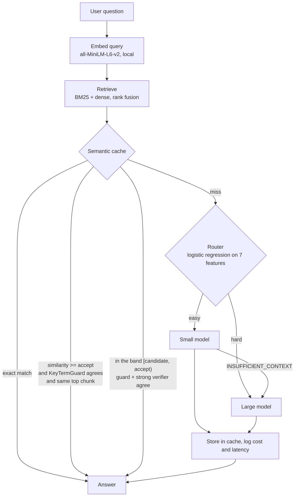
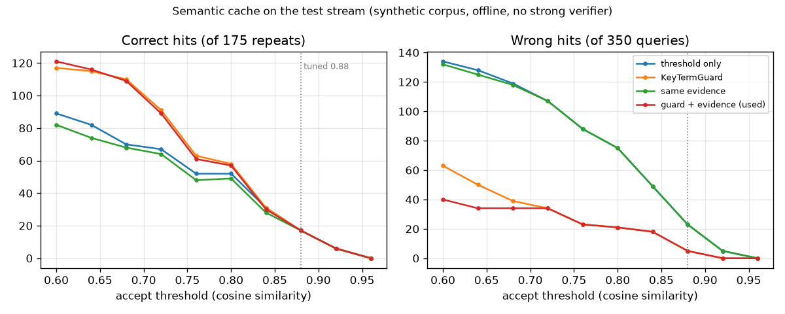

# Costwise RAG


A retrieval-augmented question-answering service that puts a **semantic cache** and a
**cost-aware model router** in front of the LLM, so cheap questions go to a small model,
repeated questions are answered from the cache, and only the hard ones pay for the large model.

The project's one claim is meant to be measured, not asserted: *lower LLM cost and p95 latency at
the same answer quality.* Every number below comes from a reproducible eval in this repo. The
offline numbers are real; **the cost and latency numbers need a paid live run that has not been
done yet** (see [Results](#results)).

## How it works



Code layout follows ports and adapters: the cache, router and pipeline are plain Python in
`src/costwise/domain/` with no I/O; embedders, retrieval indexes, verifiers, the OpenRouter client
and SQLite live in `src/costwise/adapters/`; FastAPI and the dashboard in `src/costwise/app/`; the
evals in `src/costwise/eval/`. Full design notes: [docs/ARCHITECTURE.md](docs/ARCHITECTURE.md).

## Design decisions

| Problem | Chosen | Alternatives considered | Why |
|---|---|---|---|
| When are two questions "the same"? | Embedding similarity, then **KeyTermGuard** (numbers must match as a set; units, plan names and contrast words must not be substituted), plus the same top retrieved chunk | Threshold only; always ask an LLM | Near-misses ("refund window for monthly" vs "annual") sit at the same similarity as true paraphrases; no single threshold separates them (see results). An LLM check on every lookup costs what the cache saves. |
| Cheap check vs accurate check | **Two thresholds**: above the accept threshold the free guard decides; in the band below it a strong verifier (small LLM YES/NO, or a cross-encoder) must also agree, at most once per lookup, its cost charged to the request | One threshold | Keeps the free path strict and pays for accuracy only where it is needed. |
| Cache freshness | TTL plus per-entry source-document hashes | Flush all on change; TTL only | Only answers built from a changed document are dropped. |
| Which model answers | Logistic regression on hand-made features (length, numbers, multi-part cues, clauses, documents in top-k, retrieval scores), plus escalation when the small model says the context is insufficient | Hand rules; embedding classifier (RouteLLM style); pure cascade (FrugalGPT style); LLM router | Works with 75 labelled rows, explainable; the cascade is the safety net. The heuristic router is kept as a baseline. |
| Retrieval | Hybrid BM25 + dense with reciprocal rank fusion | Dense only; BM25 only; + reranker | Exact tokens ("3000", "Starter") and paraphrases both matter; recall numbers below back it. |
| Storage, provider | NumPy brute-force search, SQLite, a thin `httpx` OpenRouter client | FAISS/Qdrant, Redis, LiteLLM | Zero setup at this size; each is a one-adapter swap. |

**Honesty rules:** thresholds and router weights are fitted on the **tune** split only and reported
on the **test** split. The corpus is a 12-document synthetic help-centre knowledge base
(39 chunks) with 60 questions (25 tune, 35 test), each with 2 paraphrases. Every percentage is
given with its counts.

## Results

### Offline (real, free to reproduce; from [results/offline.json](results/offline.json))

These need no LLM. They are real measurements, but on a small synthetic corpus, so they show the
method works rather than predict production numbers.

**Retrieval, test split, 105 queries, recall@4:** dense 102/105 (97.1%), BM25 98/105 (93.3%),
**hybrid 103/105 (98.1%)**.

**Cache, test split, 350-query stream with 175 repeats (5 stream seeds, repeat rate 0.5):**

| Variant (threshold from tune) | Hits | Correct | Wrong | Repeats served | Wrong-hit rate |
|---|---|---|---|---|---|
| Similarity threshold only (tune needs 0.99) | 0 | 0 | 0 | 0/175 (0%) | 0/350 (0%) |
| Guard + same evidence, accept 0.88 (the free config) | 22 | 17 | 5 | 17/175 (9.7%) | 5/350 (1.4%) |
| Upper bound: perfect strong verifier in the band [0.60, 0.88) | 139 | 134 | 5 | 134/175 (76.6%) | 5/350 (1.4%) |
| Upper bound: perfect strong verifier on every candidate | 138 | 138 | 0 | 138/175 (78.9%) | 0/350 (0%) |

The upper-bound rows assume a strong verifier that is never wrong; they bound what the paid LLM
verifier can reach. The last row was added after the 5 wrong test hits were seen and is reported
only; the tuned config does not use it.

**Router, test split, 105 questions (21 hand-labelled hard, 84 easy):**

| Router (threshold from tune) | Accuracy | Hard sent to large | Easy kept on small | Sent to large |
|---|---|---|---|---|
| Heuristic rules, 0.4 | 93/105 (88.6%) | 14/21 | 79/84 | 19/105 |
| Learned (logistic regression), 0.5 | 97/105 (92.4%) | 18/21 | 79/84 | 23/105 |

"Hard" is a hand label, not an observed small-model failure; the live run decides whether it
matters. The learned router fits all 75 tune rows, so it over-fits a little.

**Charts** (drawn by `scripts/make_charts.py` from results/offline.json):



The guard is what makes low thresholds usable: at 0.60 it cuts wrong hits from 134 (threshold
only) to 40 while keeping more correct hits; at the tuned 0.88 it leaves 5 wrong of 350.


### End to end (mock dry run: NOT real numbers)

[results/live_mock.json](results/live_mock.json) runs the same 140-query stream (70 repeats)
through five configurations with a **mock model that echoes the retrieved context**. Its accuracy,
cost and latency are **not real**; they only prove the harness runs end to end.

| Config | Correct | Mock cost | Routes | Cache hits |
|---|---|---|---|---|
| baseline (always large) | 124/140 | $0.3239 (mock) | large 140 | 0 |
| always small | 124/140 | $0.0162 (mock) | small 140 | 0 |
| router only | 124/140 | $0.0816 (mock) | small 112, large 28 | 0 |
| cache only | 124/140 | $0.1955 (mock) | large 84, cache 56 | 56 (2 wrong) |
| full | 124/140 | $0.0502 (mock) | small 67, large 17, cache 56 | 56 (2 wrong) |

### End to end, live (Phase 6: not run yet)

> **Placeholder.** Real cost per query, saving against always-large, p50/p95 latency and answer
> accuracy per configuration will come from one paid run on OpenRouter with a hard budget cap
> (`--max-cost 0.50`). No live number exists yet and none is claimed.

| Config | Correct | Cost | Saving vs baseline | p50 / p95 latency |
|---|---|---|---|---|
| baseline | _TBD_ | _TBD_ | n/a | _TBD_ |
| router only | _TBD_ | _TBD_ | _TBD_ | _TBD_ |
| cache only | _TBD_ | _TBD_ | _TBD_ | _TBD_ |
| full | _TBD_ | _TBD_ | _TBD_ | _TBD_ |

## How to run

Requires Python 3.11+. Commands are for Windows Git Bash; on Linux/macOS use `.venv/bin/python`.

```bash
python -m venv .venv
.venv/Scripts/python -m pip install -e ".[dev]"
```

The embedder (`all-MiniLM-L6-v2`, about 90 MB) is downloaded by `sentence-transformers` on first
use. Tests never load it and never touch the network.

```bash
.venv/Scripts/python -m pytest -q
```

```bash
PYTHONPATH=src .venv/Scripts/python -m costwise.eval.offline
```

```bash
PYTHONPATH=src .venv/Scripts/python -m costwise.eval.live --seeds 2
```

```bash
.venv/Scripts/python scripts/make_charts.py
```

Load test: N concurrent `/ask` requests, reporting throughput and p50/p95. In-process with the
mock model by default (no server, no download); `--url http://127.0.0.1:8000` hits a running
server. With the mock model it measures the service's own overhead, not LLM latency.

```bash
PYTHONPATH=src .venv/Scripts/python scripts/load_test.py -n 200 -c 8
```

```bash
PYTHONPATH=src .venv/Scripts/python -m uvicorn costwise.app.api:app
```

Then open http://127.0.0.1:8000/ for the dashboard, or `POST /ask` with `{"query": "..."}`.
`GET /stats`, `/recent` and `/cache` return JSON; `GET /metrics` serves Prometheus text format
(request counts by route, LLM and baseline cost, escalations, latency p50/p95, cache hits and
rejections). With the mock model, `costwise_info{mock="true"}` marks the cost metrics as not real. The API uses the mock model unless
`COSTWISE_LLM=openrouter` and `OPENROUTER_API_KEY` are set in the environment.

### Docker

```bash
docker compose up --build
```

The API then serves on http://localhost:8000/ with the **mock model**; the SQLite cache and
request log live in a named volume. The default embedder (MiniLM, about 90 MB) is downloaded once
on first start into a second volume; `COSTWISE_EMBED_MODEL=hash docker compose up` runs with no
download at all (weaker retrieval, demo only). No key is in the image or the compose file: for the
paid model, set `COSTWISE_LLM=openrouter` and `OPENROUTER_API_KEY` in your shell before `up`, and
compose passes them in at runtime.

The paid live eval (`--live`) spends OpenRouter credit and stops at a hard cap; see
[PROGRESS.md](PROGRESS.md) for the exact command.

## Limits

- Small synthetic corpus: the method is shown, production numbers are not.
- KeyTermGuard misses near-misses that differ only in ordinary words; above the accept threshold
  no strong verifier is asked.
- Single process: the SQLite cache is not shared across instances.
- Answers are graded by required key facts, not by a human or an LLM judge.
